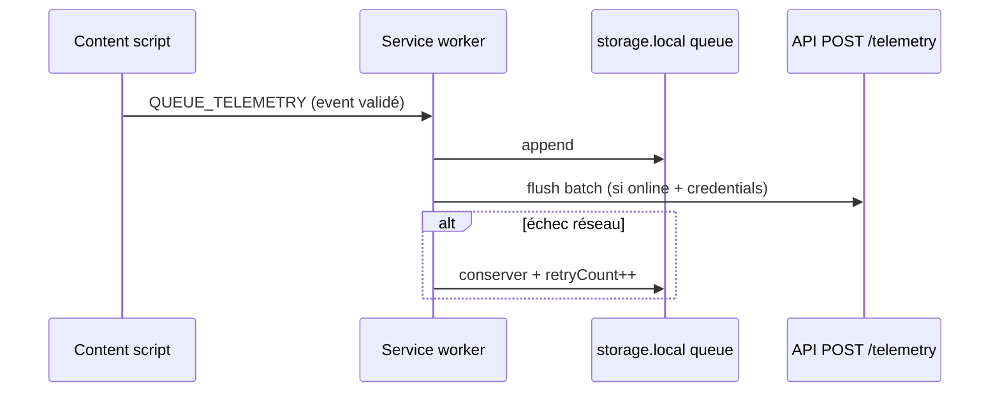

# ADR 002 — File d’attente télémétrie offline

**Statut :** Accepté  
**Date :** 2026-05-19

## Contexte

Télémétrie obligatoire B2B, mais postes peuvent être hors ligne. Aucun contenu utilisateur ne doit être mis en file.

## Décision

### Stockage

- Clé `sentinel_telemetry_queue` dans `chrome.storage.local` (max ~5 Mo — suffisant pour métadonnées).
- Structure : `TelemetryQueueItem[]` avec `{ event, queuedAt, retryCount }`.

### Flux

### Règles

1. **Validation** `validateTelemetryEvent()` avant enqueue (Phase 3).
2. **Idempotence** : `eventId` UUID v4 — l’API déduplique (Phase 4).
3. **Backoff** : exponentiel plafonné (ex. 1 min → 30 min), max 10 tentatives puis drop + log local.
4. **Batch** : envoi par paquets de 50 événements max.
5. **Pas de texte utilisateur** dans la queue — uniquement `TelemetryEvent`.

### Déclencheurs flush

- `chrome.alarms` périodique (ex. 5 min) — permission `alarms` à ajouter Phase 3.
- Événement `online` (service worker).
- Ack manuel post-config credentials (Options).

## Conséquences

- Permission `alarms` requise en Phase 3 (pas en Phase 0).
- Cap queue : 1000 événements — au-delà, supprimer les plus anciens (FIFO) avec compteur local optionnel.

## Alternatives écartées

| Alternative | Raison |
|-------------|--------|
| IndexedDB | Surdimensionné pour petits objets JSON |
| Sync storage | Données ne doivent pas suivre le compte Google employé |
| Envoi synchrone bloquant UI | Interdit (perf + offline) |
