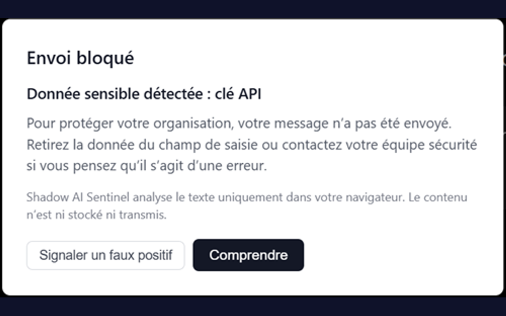
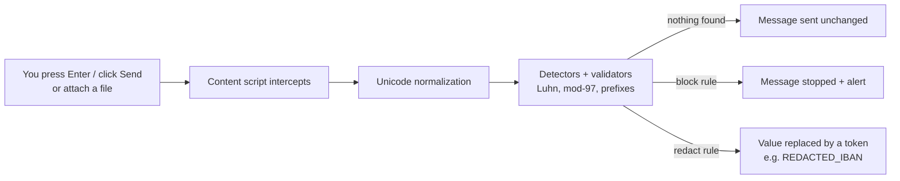

# Shadow AI Sentinel

[](https://github.com/chemGT/shadow-ai-sentinel/actions/workflows/ci.yml)
[](https://github.com/chemGT/shadow-ai-sentinel/actions/workflows/codeql.yml)
[](LICENSE)

**Open-source browser DLP for public AI chatbots.** Shadow AI Sentinel stops secrets and personal
data **before** they are sent to ChatGPT, Claude, Gemini and five other assistants — by blocking the
message or redacting the sensitive value in place.

- **100 % local.** Detection runs in your browser. The extension makes **no network request at all**:
  no backend, no analytics, no telemetry.
- **Auditable.** Every line that touches your prompt is in this repository.
- **Built for "shadow AI".** Employees paste logs, configs and customer data into public LLMs every
  day. This is a seatbelt for that moment, not a corporate surveillance tool.

[Français](README.fr.md)



---

## What it detects

| Rule | Examples | Validation | Default |
|------|----------|------------|---------|
| `api_key` | AWS `AKIA…`/`ASIA…`, OpenAI `sk-…`, Anthropic `sk-ant-…`, Stripe `sk_live_…`, GitHub `ghp_…`/`github_pat_…`, GitLab `glpat-…`, Slack `xox…`, Azure storage connection strings | Fixed prefixes, bounded lengths | Block |
| `generic_secret` | `Bearer …`, `Basic …`, JWTs | Bounded patterns | Block |
| `iban` | `FR76 3000 6000 0112 3456 7890 189`, `DE89-3704-…` | ISO 13616 mod-97 | Redact |
| `card` | Visa/Mastercard/Amex, contiguous or grouped | Luhn | Redact |
| `phone` | French national and `+33` formats, E.164 | Format | Redact |
| `internal_ip` | RFC 1918 addresses (`10.x`, `172.16–31.x`, `192.168.x`) | Range check | Redact |
| `pro_email` | Addresses on domains **you** configure | Exact domain | Off (needs a domain) |

Every rule can be switched between **Block** and **Redact**, or disabled, from the options page.
An **allowlist** silences known-safe values (test keys, your own public email…).

**Attachments** are scanned too: text/code files (`.env`, `.json`, `.csv`, source files…) and
**PDF / DOCX** (text extracted locally with pdf.js and mammoth).

**Evasion hardening:** input is normalized before scanning — zero-width characters and BOMs are
removed, Unicode spaces (NBSP, narrow NBSP) folded, Cyrillic/Greek look-alike letters and
full-width characters folded to ASCII. Redaction still applies to exactly what you typed.

## Supported sites

Claude · ChatGPT · Gemini · Mistral Le Chat · DeepSeek · Perplexity · Grok · Microsoft Copilot

If a site changes its DOM and the adapter can no longer find the message box, the extension says so
(popup warning + configurable `fail_mode`: `open`, `warn` or `closed`) instead of failing silently.

## How it works



Scanning is bounded (overlapping 100 k windows, 2 M characters max with a visible warning beyond)
and every regex is audited against ReDoS.

## Install

Store listings (Chrome Web Store, Firefox Add-ons) are planned. Until then, build from source:

```bash
git clone https://github.com/chemGT/shadow-ai-sentinel.git
cd shadow-ai-sentinel
npm ci
npm run build            # Chromium → dist/
npm run build:firefox    # Firefox  → dist-firefox/
```

- **Chrome / Edge / Brave:** `chrome://extensions` → Developer mode → *Load unpacked* → `dist/`
- **Firefox:** `about:debugging` → This Firefox → *Load Temporary Add-on* → `dist-firefox/manifest.json`

Tagged releases also ship ready-made archives on the
[Releases page](https://github.com/chemGT/shadow-ai-sentinel/releases).

## What it does **not** do

Shadow AI Sentinel protects against **accidental** leaks — the pasted log, the forgotten key in a
config file. It is not designed to stop a determined insider:

- encoded secrets (base64, hex, URL-encoding), reversed or deliberately split values are not decoded;
- images, XLSX/PPTX, archives and scanned (image-only) PDFs are not inspected;
- requests sent outside the page's message box (direct API calls, other apps) are out of reach.

The full threat model and the adversarial test corpus are public:
[`docs/security/evasion-threat-model.md`](docs/security/evasion-threat-model.md) ·
[`src/core/detection/evasion-corpus.test.ts`](src/core/detection/evasion-corpus.test.ts).

## Privacy

No account, no server, no analytics. Settings and local counters live in `chrome.storage.local`.
The only outbound action is one **you** trigger: *Report false positive* opens a prefilled GitHub
issue (rule, site, context, version — never your text). See the
[privacy policy](store-assets/privacy-policy.md).

## Development

| Command | Purpose |
|---------|---------|
| `npm test` | Unit tests (Vitest) |
| `npm run test:ci` | Unit tests + coverage |
| `npm run test:e2e` | Builds, then runs Playwright against the real extension on fixtures of the 8 sites |
| `npx tsc --noEmit` | Typecheck |
| `npm run build` / `npm run build:firefox` | Extension builds |
| `npm run package:firefox` | Unsigned `.xpi` for AMO |

```
src/
├── core/        # Detection engine (pure TS, no DOM): detectors, normalization, validators, policy
├── extension/   # MV3: background, content script, site adapters, popup, options
└── ui/          # React alert components, i18n (EN/FR)
e2e/             # Playwright suite + site fixtures
```

Stack: TypeScript, React 19, Vite + CRXJS, Vitest, Playwright, pdf.js, mammoth.

## Documentation

[docs/](docs/README.md) — threat model, bypass log, ReDoS audit, compliance notes (GDPR, NIS2,
AI Act) with employee-notice templates, per-site selectors. What's next: [ROADMAP.md](ROADMAP.md).

## Contributing

Bug reports, false positives, new detectors and site-adapter fixes are welcome — see
[CONTRIBUTING.md](CONTRIBUTING.md). Security issues: [SECURITY.md](SECURITY.md).
This project follows the [Contributor Covenant](CODE_OF_CONDUCT.md).

## License

[Apache-2.0](LICENSE) · see [NOTICE](NOTICE).
